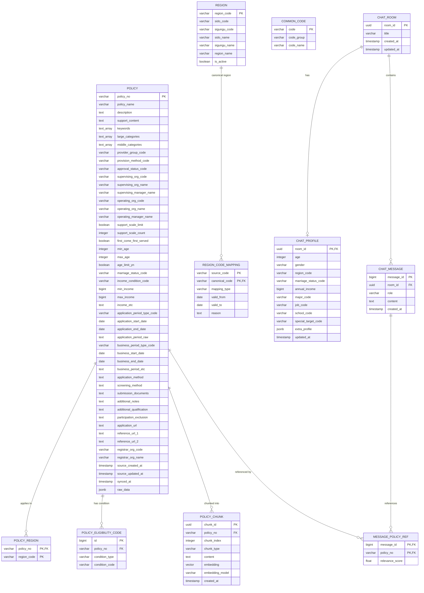
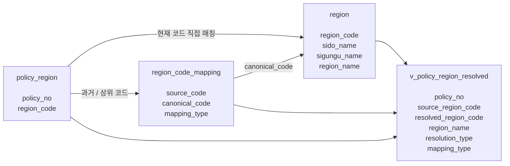

# YouthLink Database ERD

PostgreSQL + pgvector 기반 프로토타입 데이터베이스 구조입니다.

## Table groups

### Policy domain
- `policy`
- `policy_region`
- `region`
- `region_code_mapping`
- `policy_eligibility_code`
- `common_code`

### RAG domain
- `policy_chunk`

### Chat domain
- `chat_room`
- `chat_profile`
- `chat_message`
- `message_policy_ref`

## 지역 코드 관계

`policy_region.region_code`에는 온통청년 API의 원본 `zipCd`를 그대로 저장합니다. 원본에는 현재 VWorld 코드뿐 아니라 과거·폐지·상위 코드가 포함될 수 있으므로 `policy_region.region_code`와 `region.region_code` 사이에 외래키를 강제하지 않습니다.

`region`은 VWorld에서 동기화한 현재 시도·시군구 마스터입니다. `region_code_mapping`은 원본 코드인 `source_code`를 현재 코드인 `canonical_code`에 연결하며, `(source_code, canonical_code)` 복합 기본키로 지역 분할에 따른 1:N 매핑을 지원합니다. ERD의 `REGION` → `REGION_CODE_MAPPING` 관계는 `canonical_code`가 참조하는 현재 지역을 나타냅니다.

## `v_policy_region_resolved` View

`v_policy_region_resolved`는 RAG와 백엔드가 지역 코드의 변경 이력을 매번 직접 처리하지 않도록 다음 세 객체를 결합한 조회용 View입니다.

View는 정책별 원본 코드와 해석된 현재 코드·지역명을 함께 제공하며, 해석 방식은 `resolution_type`으로 구분합니다.

| `resolution_type` | 의미 |
| --- | --- |
| `DIRECT` | `policy_region.region_code`가 현재 `region.region_code`와 직접 일치 |
| `MAPPED` | 원본 코드가 `region_code_mapping`을 거쳐 하나 이상의 현재 코드로 해석됨 |
| `UNRESOLVED` | 현재 지역과 매핑 어디에서도 원본 코드를 해석할 수 없음 |

주요 컬럼은 `policy_no`, `source_region_code`, `resolved_region_code`, `sido_code`, `sigungu_code`, `sido_name`, `sigungu_name`, `region_name`, `is_active`, `resolution_type`, `mapping_type`, `valid_from`, `valid_to`입니다. RAG·백엔드의 지역 필터는 원본 코드 대신 `resolved_region_code`를 사용하고, 운영 점검에서는 `resolution_type = 'UNRESOLVED'`인 행을 확인합니다.
