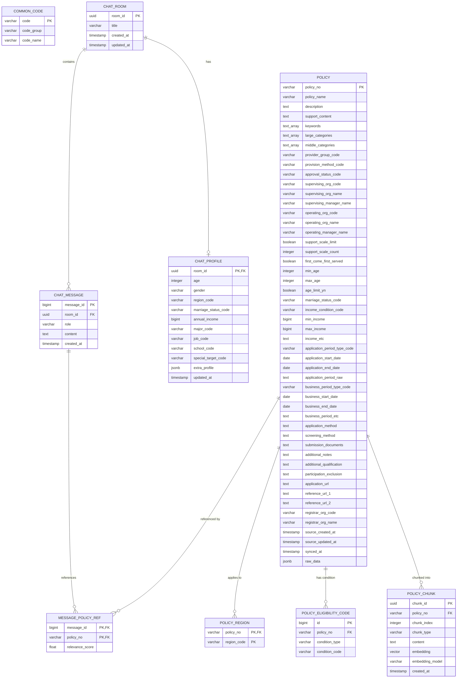

# YouthLink Database ERD

PostgreSQL + pgvector 기반 프로토타입 데이터베이스 구조입니다.

## Table groups

### Policy domain
- `policy`
- `policy_region`
- `policy_eligibility_code`
- `common_code`

### RAG domain
- `policy_chunk`

### Chat domain
- `chat_room`
- `chat_profile`
- `chat_message`
- `message_policy_ref`